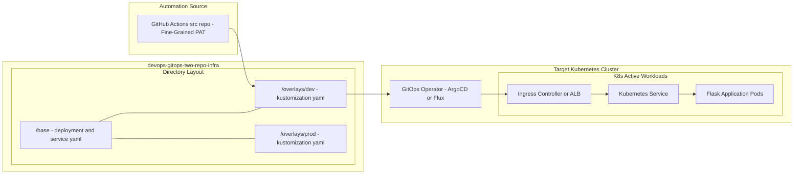

# Enterprise Infrastructure & GitOps CD (`devops-gitops-two-repo-infra`)

[](https://github.com/adam-lechnos/devops-gitops-two-repo-infra/actions)
[](https://opensource.org/licenses/MIT)

This repository serves as the **Single Source of Truth (SSOT)** for declarative Kubernetes infrastructure, environment overlays, and continuous delivery (CD) governance. It pairs directly with the [Application Source Repo](https://github.com/adam-lechnos/devops-gitops-two-repo-src) to enforce a secure Two-Repo GitOps model.

---

## 🛡️ Governance & Security Model

Designed around strict enterprise compliance standards (NIST / State IT governance):
* **No Direct Production Commits:** All changes to QA and Production environments must go through a peer-reviewed Pull Request workflow.
* **Automated Policy Gates:** Every Pull Request triggers automated `kustomize build` rendering and **Kubeconform** schema validation before merge approval.
* **Declarative CD:** Synchronized continuously to target Kubernetes clusters via **ArgoCD**.

---

## 📂 Repository Structure

```text
.
├── base/                   # Shared Kubernetes manifests (Deployment, Service, etc.)
└── overlays/
    ├── dev/                # Automated environment (Tracks latest Git SHA via CI)
    ├── qa/                 # Gated pre-production testing environment
    └── prod/               # Stable production environment (SemVer pinned)

```

## 🏗️ Architectural Overview

